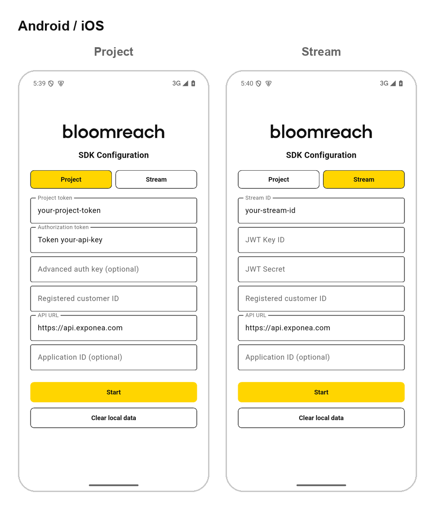
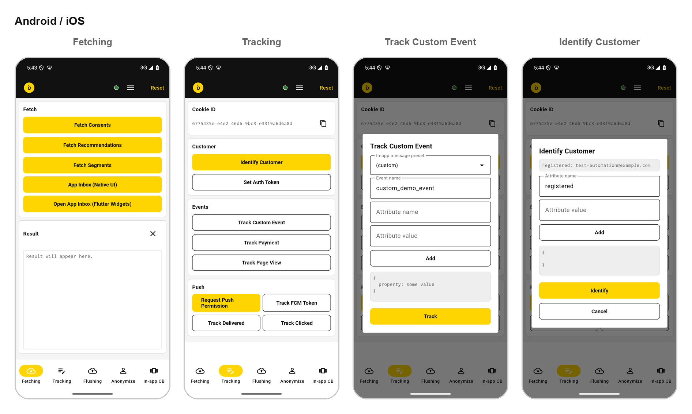
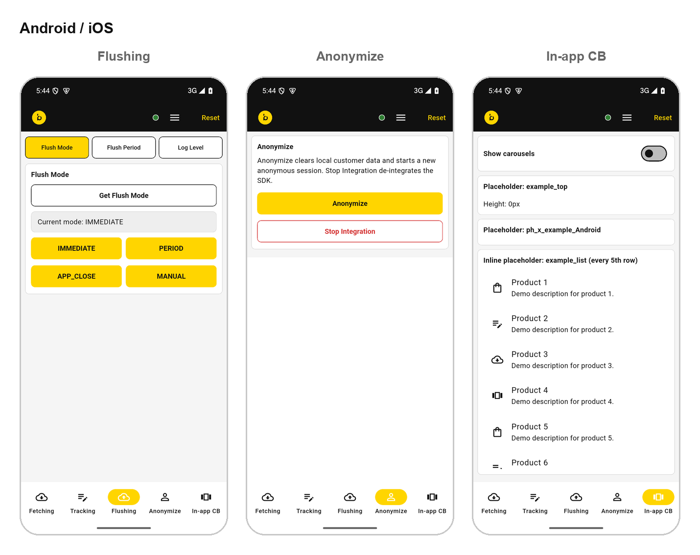

The Exponea Flutter SDK includes an example application you can use as a reference implementation. You can build and run the app, test {user.mkg} features, and compare the code and behavior of your implementation with the expected behavior and code in the example app.

## Prerequisites

You must have the following software installed to be able to build and run the example app:

- [Flutter SDK](https://docs.flutter.dev/tools/sdk)
- [Git](https://git-scm.com/)
- [Android Studio](https://developer.android.com/studio) with a virtual or physical device set up to run the app on Android
- [Xcode](https://developer.apple.com/xcode/) and [CocoaPods](https://cocoapods.org/) with a virtual or physical device set up to run the app on iOS

> 👍
>
> Follow Flutter's [Get started](https://docs.flutter.dev/get-started/install) guide if you are new to Flutter.

## Build and run the example app

1. Clone the [exponea-flutter-sdk](https://github.com/exponea/exponea-flutter-sdk) repository on GitHub:
   ```shell
   git clone https://github.com/exponea/exponea-flutter-sdk.git
   ```
2. Enter the `example` directory containing the example app and install dependencies:
   ```shell
   cd exponea-flutter-sdk/example
   flutter pub get
   ```
3. To run the app on iOS:
   1. Run CocoaPods in the `ios` directory to install dependencies:
      ```shell
      cd ios
      pod install
      cd ..
      ```
   2. Connect a virtual or physical iOS device.
   3. Run the app:
      ```shell
      flutter run
      ```
4. To run the app on Android:
   1. Connect a virtual or physical Android device.
   2. Run the app:
      ```shell
      flutter run --flavor gms
      ```
      Alternatively, use `--flavor hms` for Huawei devices without Google Play services but with HMS Core.
      > 👍
      >
      > If you use Visual Studio Code, you can create a [launch configuration](https://code.visualstudio.com/docs/editor/debugging#_launch-configurations) to use the flavor flag.

> 📘
>
> To enable push notifications in the example app, you must also configure the [Firebase integration](https://documentation.bloomreach.com/engagement/docs/android-sdk-configure-firebase) or [Huawei integration](https://documentation.bloomreach.com/engagement/docs/android-sdk-configure-huawei) in the {user.mkg} web app. Use the `gms` product flavor for Firebase or the `hms` flavor for Huawei. On iOS, the example app includes notification service and content extensions for rich push notifications. Rich push notifications require a physical device.

## Navigate the example app



Run the app to open the **SDK Configuration** screen. The fields change depending on the selected integration type. To set it up:

1. Select your integration type using the **Project** or **Stream** toggle.
2. For **Project**:
   - Enter your **Project token**.
   - Enter your **Authorization token** (API key).
   - **Optional:** Enter **Advanced auth key** to enable [customer token authorization](https://documentation.bloomreach.com/engagement/docs/flutter-sdk-authorization#customer-token-authorization).
3. For **Stream**:
   - Enter your **Stream ID**. Find the stream ID in the {user.dh} app under **Event streams** > select your stream > **Access Security**.
   - **Optional:** Enter **JWT Key ID** and **JWT Secret** to enable local JWT token generation for testing. Both must be provided together. Refer to [SDK auth token authorization](https://documentation.bloomreach.com/engagement/docs/flutter-sdk-authorization#sdk-auth-token-authorization) for details.
4. Enter the **API URL** (API base URL for the {user.br} platform).
5. **Optional:** Enter an email address hard ID in the **Registered customer ID** field to identify the customer. Leave blank for anonymous tracking.
6. **Optional:** Enter **Application ID (optional)** if your {user.mkg} project supports multiple mobile apps. If you leave this blank, the SDK uses the default value `default-application`. For more details, see [Configuration for Flutter SDK](https://documentation.bloomreach.com/engagement/docs/flutter-sdk-configuration).
7. Click **Start** to [initialize the SDK](https://documentation.bloomreach.com/engagement/docs/flutter-sdk-setup#initialize-the-sdk).

The **Clear local data** button invokes `ExponeaPlugin().clearLocalCustomerData()` to delete all locally stored data without initializing the SDK.

- [`authentication_screen.dart`](https://github.com/exponea/exponea-flutter-sdk/blob/main/example/lib/features/authentication/authentication_screen.dart)
- [`plugin_exponea_service.dart`](https://github.com/exponea/exponea-flutter-sdk/blob/main/example/lib/services/plugin_exponea_service.dart)

> 👍
>
> When using **Project** integration, prefix your API key with `Token `, for example:
> `Token 0b7uuqicb0fwuv1tqz7ubesxzj3kc3dje3lqyqhzd94pgwnypdiwxz45zqkhjmbf`.



After initialization, the main screen provides bottom navigation to test different SDK features. The app bar also includes:
   * SDK status indicator
   * SDK configuration overview
   * Logs bottom sheet
   * **Reset** action that returns to the **SDK Configuration** screen

- The **Fetching** screen enables you to fetch consents, recommendations, and segments, and open the App Inbox.
  - [`fetching_screen.dart`](https://github.com/exponea/exponea-flutter-sdk/blob/main/example/lib/features/fetching/fetching_screen.dart)

- The **Tracking** screen shows the customer's cookie ID and enables you to identify the customer, set the SDK auth token (**Stream** integration), track custom events, payments, and page views, request push permission, and track push tokens and push delivered and clicked events. The **Track Custom Event** dialog includes presets that trigger the test in-app messages, for example `Modal`, `Fullscreen`, `Slide-in`, and `Alert Rich`.
  - [`tracking_screen.dart`](https://github.com/exponea/exponea-flutter-sdk/blob/main/example/lib/features/tracking/tracking_screen.dart)
  - [`identify_customer_dialog.dart`](https://github.com/exponea/exponea-flutter-sdk/blob/main/example/lib/features/tracking/identify_customer_dialog.dart)
  - [`track_custom_event_dialog.dart`](https://github.com/exponea/exponea-flutter-sdk/blob/main/example/lib/features/tracking/track_custom_event_dialog.dart)

- The **Flushing** screen lets you read and change the flush mode and flush period, trigger a manual data flush, and read and change the SDK log level.
  - [`flushing_screen.dart`](https://github.com/exponea/exponea-flutter-sdk/blob/main/example/lib/features/flushing/flushing_screen.dart)

- The **Anonymize** screen lets you anonymize the current customer and stop the SDK integration.
  - [`anonymize_screen.dart`](https://github.com/exponea/exponea-flutter-sdk/blob/main/example/lib/features/anonymize/anonymize_screen.dart)

- The **In-app CB** screen displays in-app content blocks. Use the placeholder IDs `example_top`, `example_list`, and `example_carousel` in your in-app content block settings. Use `ph_x_example_iOS` and `ph_x_example_Android` to test platform-specific content blocks, and `example_carousel_ios` and `example_carousel_and` for platform-specific carousels.
  - [`content_blocks_screen.dart`](https://github.com/exponea/exponea-flutter-sdk/blob/main/example/lib/features/content_blocks/content_blocks_screen.dart)

The app also logs segmentation data, in-app message actions, and received and opened push notifications to the logs bottom sheet, so you can see the SDK callbacks in action.

Try out the different features in the app, then find the customer profile in the {user.mkg} web app (under `Data & Assets` > `Customers`) to see the properties and events tracked by the SDK.

If you left the **Registered customer ID** field blank, the customer is tracked anonymously using a cookie soft ID. You can look up the cookie value on the **Tracking** screen and find the corresponding profile in the {user.mkg} web app.

If you entered a hard ID — for example, an email address — in the **Registered customer ID** field, you can find the customer in the {user.mkg} web app by their email address.

> 📘
>
> For more information on soft IDs and hard IDs, see [Customer identification](https://documentation.bloomreach.com/engagement/docs/customer-identification).



## Troubleshooting

If you encounter any issues running the example app, the following may help:

- In the `example` directory, run `flutter clean`, then `flutter pub get`.
- If the app doesn't start on Android, you may have forgotten to include the `--flavor gms` or `--flavor hms` flag.
- If Android refuses to install the app over an existing installation (`INSTALL_FAILED_UPDATE_INCOMPATIBLE`), uninstall the previous build once. The example app is signed with a shared demo key.
