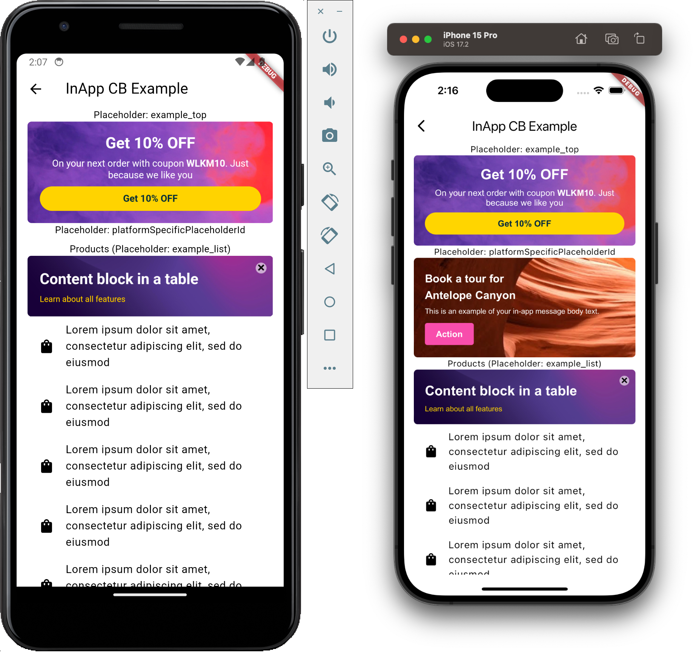

In-app content blocks provide a way to display campaigns within your mobile applications that seamlessly blend with the overall app design. Unlike [In-app messages for Flutter SDK](https://documentation.bloomreach.com/engagement/docs/flutter-sdk-in-app-messages) that appear as overlays or pop-ups demanding immediate attention, in-app content blocks display inline with the app's existing content.

You can strategically position placeholders for in-app content blocks within your app. You can customize the behavior and presentation to meet your specific requirements.

> 📘
>
> Refer to the [In-app content blocks](https://documentation.bloomreach.com/engagement/docs/in-app-content-blocks) user guide for instructions on how to create in-app content blocks in {user.mkg}.



## Integration

You can integrate in-app content blocks by adding one or more placeholder views in your app. Each in-app content block must have a `Placeholder ID` specified in its [settings](https://documentation.bloomreach.com/engagement/docs/in-app-content-blocks#3-fill-the-settings) in {user.mkg}. The SDK will display an in-app content block in the corresponding placeholder in the app if the current app user matches the target audience.

### Add a placeholder view

Add a placeholder view with the specified `placeholderId` to your layout:

```dart
InAppContentBlockPlaceholder(
  placeholderId: "example_content_block"
)
```

After the SDK initializes (see [Initial setup for Flutter SDK](https://documentation.bloomreach.com/engagement/docs/flutter-sdk-setup#initialize-the-sdk)), it will identify any in-app content blocks with matching placeholder ID and select the one with the highest priority to display within the placeholder view.

> 📘
>
> For a reference implementation, see [`content_blocks_screen.dart`](https://github.com/exponea/exponea-flutter-sdk/blob/main/example/lib/features/content_blocks/content_blocks_screen.dart) in the [Example app for Flutter SDK](https://documentation.bloomreach.com/engagement/docs/flutter-sdk-example-app).

> 👍
>
> Always us descriptive, human-readable placeholder IDs. They are tracked as an event property and can be used for analytics within {user.mkg}.

## Integration of a carousel view

If you want to show multiple in-app content blocks to the user for the same `Placeholder ID`, consider using `InAppContentBlockCarousel`. The SDK will display the in-app content blocks for the current app user in a loop, in order of `Priority`. The in-app content blocks are displayed in a loop until the user interacts with them or until the carousel view instance is reloaded programmatically.

If the carousel view's placeholder ID only matches a single in-app content block, it will behave like a static placeholder view with no loop effect.

### Add a carousel view

Add a carousel view with the specified `placeholderId` to your layout:

```dart
InAppContentBlockCarousel(
  placeholderId: 'example_carousel',
  scrollDelay: 5, // delay in seconds between automatic scroll; 0 for no scroll; default value is 3
  maxMessagesCount: 5, // max count of visible content blocks; 0 for show all; default value is 0
)
```

> 📘
>
> For a reference implementation, see [`content_blocks_screen.dart`](https://github.com/exponea/exponea-flutter-sdk/blob/main/example/lib/features/content_blocks/content_blocks_screen.dart) in the [Example app for Flutter SDK](https://documentation.bloomreach.com/engagement/docs/flutter-sdk-example-app).

> 👍
>
> Always us descriptive, human-readable placeholder IDs. They are tracked as an event property and can be used for analytics within {user.mkg}.

## Tracking

The SDK automatically tracks `banner` events for in-app content blocks with the following values for the `action` event property:

- `show`
  In-app content block displayed to user.
- Event is tracked everytime if Placeholder view is used. Carousel view tracks this event only if content block is shown for first time after
- `action`
  User clicked on action button inside in-app content block. The event also contains the corresponding `text` and `link` properties.
- `close`
  User clicked on close button inside in-app content block.
- `error`
  Displaying in-app content block failed. The event contains an `error` property with an error message.

> ❗️
>
> The behavior of in-app content block tracking may be affected by the tracking consent feature, which in enabled mode requires explicit consent for tracking. Refer to the [Tracking consent for Flutter SDK](https://documentation.bloomreach.com/engagement/docs/flutter-sdk-tracking-consent) documentation for details.

## Customization

### Prefetch in-app content blocks

The SDK can only display an in-app content block after it has been fully loaded (including its content, any images, and its height). Therefore, the in-app content block may only show in the app after a delay.

Hide this delay by warming the content for specific placeholders before the user reaches the screen that renders them. Use `ExponeaPlugin().inAppContentBlocksController?.prefetch()`, described in [Control in-app content blocks at runtime](#control-in-app-content-blocks-at-runtime). The existing `InAppContentBlockPlaceholder` and `InAppContentBlockCarousel` widgets still own rendering and tracking.

```dart
// Call this as soon as the destination screen (and its placeholder IDs) is known,
// for example when the user taps a navigation item.
await ExponeaPlugin().inAppContentBlocksController?.prefetch(['placeholder_1']);
```

Alternatively, if the placeholder IDs are static, you can let the SDK load them right after initialization by listing them in the `inAppContentBlockPlaceholdersAutoLoad` [configuration parameter](https://documentation.bloomreach.com/engagement/docs/flutter-sdk-configuration). The runtime controller is the better choice whenever IDs depend on navigation, customer identity, or CMS layout.

```dart
final config = ExponeaConfiguration(
    ...
    inAppContentBlockPlaceholdersAutoLoad: ['placeholder_1'],
    ...
);
final configured = await ExponeaPlugin().configure(config);
```

### Control in-app content blocks at runtime

`ExponeaPlugin().inAppContentBlocksController` is a runtime controller for in-app content blocks. It lets you warm content before navigation, make a time-bounded rendering decision, and evict content you know has changed. The controller loads content in the background; the existing placeholder and carousel widgets still own rendering and tracking.

The controller changes with the SDK state as follows:

* Before you call `configure()`, the controller is `null`.
* After `configure()` completes, the controller is available.
* If you call `configure()` again while the SDK is already configured, the controller stays the same instance. In this case, `configure()` returns `false`.
* After `identifyCustomer()` or `anonymize()`, the controller stays the same instance. The native SDK resets its cache on a customer change, so prefetch again afterward.
* After a successful `stopIntegration()`, the controller is `null`.
* After a `configure()` call that follows `stopIntegration()`, the controller is a new instance.

Always read `ExponeaPlugin().inAppContentBlocksController` when you need it instead of keeping a long-lived reference. A reference kept across `stopIntegration()` rejects every call.

```dart
final controller = ExponeaPlugin().inAppContentBlocksController;
if (controller == null) {
  // SDK is not configured; render your fallback.
  return;
}
```

> 📘
>
> Flutter holds the controller state on the Dart side. After a hot restart, the native SDK stays configured, but the Dart state resets. The getter returns `null` until `configure()` runs again or the plugin checks with the native SDK whether it's configured. The plugin runs this check right after you create the first `ExponeaPlugin()`. A secondary Flutter engine or isolate that hasn't called `configure()` also sees `null`.

#### Which API to use

| API | Use it when | Result |
| --- | --- | --- |
| `prefetch(ids, [deadlineMs])` | The IDs for a future screen are already known and content should be warmed before navigation. | `Future` of a map from distinct ID to `InAppContentBlockAvailability` (`ready`, `empty`, or `loading`). |
| `availability(id, deadlineMs)` | The current screen must decide whether to render one placement or a fallback within a deadline. | `Future` of `InAppContentBlockAvailabilityResolved` (with `ready` or `empty`) or `InAppContentBlockAvailabilityTimedOut`. |
| `invalidate(ids, reason, [mode])` | The content of a placement changed in {user.mkg}, and the SDK must no longer show the cached version. | `Future<void>` that completes after the native controller accepts the request. |

`prefetch` accepts multiple placeholder IDs and deduplicates repeated IDs. Use it to hide loading time before a user reaches a screen. `availability` accepts only a single ID because it represents one UI decision. All three methods return a `Future` and fail if the native SDK isn't configured.

#### Handle errors

Runtime methods fail with a `PlatformException`. Known error codes are the same on iOS and Android, and the same as in the React Native SDK:

| Error code | Meaning |
| --- | --- |
| `RuntimeInAppContentBlockControllerUnavailable` | The native controller is unavailable because the SDK isn't configured, or the Dart controller instance was deactivated by `stopIntegration()`. |
| `RuntimeInAppContentBlockControllerInvalidMode` | The bridge received an unsupported invalidation mode. Use `InAppContentBlockInvalidateMode.eager` or `.lazy`. |
| `RuntimeInAppContentBlockControllerError` | An unexpected native failure occurred. Native error details are preserved in `message` and `details`. |

A deactivated instance remains unusable even after configuring the SDK again. Obtain a new instance from `ExponeaPlugin().inAppContentBlocksController` after configuration succeeds. Reading a `null` controller is not itself an error; the `?.` operator skips the operation.

```dart
final controller = ExponeaPlugin().inAppContentBlocksController;
if (controller != null) {
  try {
    await controller.prefetch(['example_list']);
  } on PlatformException catch (error) {
    if (error.code == 'RuntimeInAppContentBlockControllerUnavailable') {
      // Show your fallback. Obtain a fresh controller after configuration.
    } else {
      debugPrint('Content block prefetch failed: $error');
    }
  }
}
```

An availability timeout is an `InAppContentBlockAvailabilityTimedOut` decision, not an error. An `empty` availability result is also a normal result.

#### Warm content before navigation

Start prefetching as soon as you know the destination or its layout. Once an ID is `ready`, mount the corresponding `InAppContentBlockPlaceholder` (or `InAppContentBlockCarousel`) to use the prefetched content. Prefetching reduces loading work, but it doesn't guarantee immediate display, because display eligibility, rendering, and layout still apply.

```dart
Future<void> openProductList(BuildContext context) async {
  final results = await ExponeaPlugin()
      .inAppContentBlocksController
      ?.prefetch(['example_list'], 2000);
  if (results?['example_list'] == InAppContentBlockAvailability.ready) {
    // Content is warmed; mount the placeholder on the destination screen.
    // Display eligibility, rendering, and layout still apply.
  }
  if (context.mounted) Navigator.of(context).pushNamed('/products');
}
```

The deadline is optional. Without one, the `Future` waits for final states (`ready` or `empty`). With a deadline, the `Future` reports every ID that hasn't resolved by that time as a snapshot: `loading` on iOS and `empty` on Android. In both cases, the value is temporary and doesn't prove that no campaign exists. The background request continues and might populate the cache later. To decide the UI fallback, use `availability` instead of a deadline-bound `prefetch` result.

#### Make a bounded rendering decision

Use `availability` when waiting too long would make the screen feel slow and a fallback is acceptable.

```dart
final decision = await ExponeaPlugin()
    .inAppContentBlocksController
    ?.availability('example_list', 2000);

setState(() {
  _showContentBlock = switch (decision) {
    // Mount InAppContentBlockPlaceholder(placeholderId: 'example_list').
    InAppContentBlockAvailabilityResolved(
      availability: InAppContentBlockAvailability.ready
    ) =>
      true,
    // 'empty': load completed without renderable content.
    InAppContentBlockAvailabilityResolved() => false,
    // Timed out or SDK not configured: show your own fallback.
    InAppContentBlockAvailabilityTimedOut() || null => false,
  };
});
```

A resolved `empty` decision means the load completed without renderable content. `InAppContentBlockAvailabilityTimedOut` means only that this caller stopped waiting. It doesn't cancel the load, so a later `availability` call or a placeholder mount can use content that finishes loading afterward. A resolved decision is never `loading`.

#### Calling both APIs for the same ID

Calling the following methods together is safe:

```dart
final controller = ExponeaPlugin().inAppContentBlocksController;
controller?.prefetch(['example_list'], 2000);
final decision = await controller?.availability('example_list', 2000);
```

They share one in-flight load for `example_list` and don't create two initial requests. Each `Future` still completes exactly once with its own result type. Use this pairing when the screen needs both proactive prefetching and a deadline-based UI fallback. In most flows, prefetching before navigation is enough.

With a deadline of zero or a negative value, both methods return immediately:
* `availability` returns `InAppContentBlockAvailabilityTimedOut`.
* `prefetch` returns cached terminal states and the snapshot value for other IDs.

Both still start or continue populating the cache in the background.

#### Prefetch after identifying the customer

Content block eligibility depends on the customer. The native SDK resets its runtime cache when the customer changes, so a prefetch issued before `identifyCustomer()` completes may be evaluated for the previous (anonymous) customer. Order the calls as follows:

```dart
final plugin = ExponeaPlugin();
await plugin.identifyCustomer(const Customer(ids: {'registered': 'user@example.com'}));
// The controller instance is unchanged, only its cache was reset.
await plugin.inAppContentBlocksController?.prefetch(['home_banner', 'home_list']);
```

The same applies after `anonymize()`.

#### Invalidate changed content

`invalidate(ids, reason, [mode])` evicts the cached content of the given placements. In the default `InAppContentBlockInvalidateMode.eager` mode, it also immediately starts a fresh load. In `InAppContentBlockInvalidateMode.lazy` mode, it only evicts, and the next `prefetch`, `availability`, or placeholder load fetches the content.

The `reason` is a local diagnostic label that the SDK writes to verbose logs only. The SDK never persists it or sends it over the network. The method accepts unknown IDs and starts loading them.

```dart
await ExponeaPlugin().inAppContentBlocksController?.invalidate(
  ['example_list'],
  'content updated in CMS',
  InAppContentBlockInvalidateMode.eager,
);
```

> ❗️
>
> Call `invalidate` only when the placement's source content has changed. Don't call it to acknowledge or consume a successful prefetch. Calling it right after a `ready` result discards the prefetched content and triggers another request.

##### Refresh a mounted placeholder after invalidate

The controller only evicts and reloads cached content. It doesn't refresh an `InAppContentBlockPlaceholder` or `InAppContentBlockCarousel` that's already mounted, so the widget keeps showing the content it loaded. To display the refreshed content, remount the widget by giving it a new `Key`. This creates a new platform view that loads the invalidated placement again. The example app's runtime lab uses the same pattern.

```dart
class PromoBanner extends StatefulWidget {
  const PromoBanner({super.key});

  @override
  State<PromoBanner> createState() => _PromoBannerState();
}

class _PromoBannerState extends State<PromoBanner> {
  Key _bannerKey = UniqueKey();

  Future<void> onPromoCodeApplied() async {
    await ExponeaPlugin().inAppContentBlocksController?.invalidate(
      ['promo_banner'],
      'promo code applied',
    );
    // A new key creates a new platform view, which loads the fresh content.
    setState(() => _bannerKey = UniqueKey());
  }

  @override
  Widget build(BuildContext context) {
    return InAppContentBlockPlaceholder(
      key: _bannerKey,
      placeholderId: 'promo_banner',
    );
  }
}
```

A remount briefly resets the placeholder height and tracks a new `show` event for the content block. Content that is mounted for the first time after `invalidate` needs no special handling.

#### Try the runtime controller in the example app

Open the in-app content blocks screen and select **Runtime Control**. The **Basic** tab contains the existing placeholder and carousel examples. The runtime lab accepts comma-separated or newline-separated placeholder IDs and a deadline in milliseconds. The lab records method results and placeholder events in a log that you can copy.

The **happy path** and **post-login CMS** scenarios prefetch and then mount placeholders to display eligible content. The other scenarios test prefetch, availability, eager or lazy invalidation, and customer lifecycle changes without mounting new placeholders. Blocks already mounted in the lab remain mounted during those scenarios. The happy path and post-login scenarios replace them when they mount new views. Switching away from the runtime tab unmounts the lab.

The identity scenarios change the SDK customer to `user_a`, `user_b`, or an anonymous customer. The timeout scenario uses a 1 ms deadline, but a fast response can still resolve within that time. Check the actual decision in the log.

The lab retains the last placeholder IDs and deadline across tab and screen changes until the app restarts. It doesn't retain logs and mounted views when the lab unmounts.

### Customize action behavior

When an in-app content block action (show, click, close, error) is performed, by default, the SDK tracks the appropriate event and, in case of a button click, opens a link.

You can override or customize this behavior by setting `overrideDefaultBehavior` parameter to `true` and setting callbacks on the `InAppContentBlockPlaceholder`.

The example below calls the original tracking methods. This is recommended but not required.

```dart
InAppContentBlockPlaceholder(
  placeholderId: 'example_content_block',
  overrideDefaultBehavior: true,
  onMessageShown: (placeholderId, contentBlock) {
    //track 'show' event.
    _plugin.trackInAppContentBlockShown(placeholderId, contentBlock);
    print("Content block shown: $contentBlock");
  },
  onNoMessageFound: (placeholderId) {
    print('Content block for $placeholderId not found');
    // you may set this placeholder hidden
  },
  onActionClicked: (placeholderId, contentBlock, action) {
    _plugin.trackInAppContentBlockClick(placeholderId, contentBlock, action);

    // content block action has to be handled for given `action.url`
    handleUrlByYourApp(action.url);
  },
  onCloseClicked: (placeholderId, contentBlock) {
    //track 'close' event.
    _plugin.trackInAppContentBlockClose(placeholderId, contentBlock);
    // placeholder may show another content block if is assigned to placeholder ID
  },
  onError: (placeholderId, contentBlock, errorMessage) {
    _plugin.trackInAppContentBlockError(placeholderId, contentBlock, errorMessage);
    // you may set this placeholder hidden and do any fallback
  },
)
```

### Handle carousel presentation status

You can register a multiple callbacks to a carousel view instance to retrieve information for each update and/or change behaviour by setting the `trackActions` and `overrideDefaultBehavior` flags.

* trackActions
  * If `false`, events "close" and "click" on banners won't be tracked by the SDK. Events "show" and "error" are tracked regardless from this flag.
  * If `true`, events "close" and "click" are tracked by the SDK.
  * Default behaviour is as with value `true`, all events are tracked by the SDK
* overrideDefaultBehavior
  * If `true`, deep-links and universal links won't be opened by SDK. This does not affect tracking behaviour.
  * If `false`, deep-links and universal links will be opened by SDK.
  * Default behaviour is as with value `false`, action links are opened by SDK.

```dart
InAppContentBlockCarousel(
  placeholderId: 'example_carousel',
  // If overrideDefaultBehavior is set to true, default action will not be performed (deep link, universal link, etc.)
  overrideDefaultBehavior: false,
  // If trackActions is set to false, click and close in-app content block events will not be tracked automatically
  trackActions: true,
  scrollDelay: 5, // delay in seconds between automatic scroll; 0 for no scroll; default value is 3
  maxMessagesCount: 5, // max count of visible content blocks; 0 for show all; default value is 0
  onMessageShown: (placeholderId, contentBlock, index, count) {
    // This is triggered on each scroll so 'contentBlock' parameter represents currently shown content block,
    // so as 'index' represents position index of currently shown content block
  },
  onMessagesChanged: (count, contentBlocks) {
    // This is triggered after 'reload' or if a content block is removed because interaction has been done
    // and message has to be shown until interaction.
  },
  onNoMessageFound: (placeholderId) {
    // This is triggered after `reload` when no content block has been found for a given placeholder.
  },
  onError: (placeholderId, contentBlock, errorMessage) {
    // This is triggered when an error occurs while loading or showing of content block.
    // Parameter `contentBlock` is the content block which caused the error or undefined in case of general problem.
    // Parameter `errorMessage` is the error message that describes the problem.
  },
  onCloseClicked: (placeholderId, contentBlock) {
    // This is triggered when a content block is closed.
  },
  onActionClicked: (placeholderId, contentBlock, action) {
    // This is triggered when a content block action is clicked.
    // Parameter `action` contains the action information.
  },
)
```

### Customize carousel view filtration and sorting

A carousel view filters available content blocks in the same way as a placeholder view:

- The content block must meet the `Schedule` setting configured in the {user.mkg} web app
- The content block must meet the `Display` setting configured in the {user.mkg} web app
- The content must be valid and supported by the SDK

The order in which content blocks are displayed is determined by:

1. By the `Priority` setting, descending
2. By the `Name`, ascending (alphabetically)

You can implement additional filtration and sorting by registering your own `filterContentBlocks` and `sortContentBlocks` on the carousel view instance:

```dart
InAppContentBlockCarousel(
  placeholderId: 'example_carousel',
  // The SDK waits up to 500 ms for each custom filter or sort result.
  responseTimeoutMillis: 500,
  filterContentBlocks: (contentBlocks) {
    // if you want keep default filtration, do not register this method
    // you can add your own filtration, for example ignore any item named "discarded"
    return contentBlocks.where((block) => block.name != 'discarded').toList();
  },
  sortContentBlocks: (contentBlocks) {
    // if you want to keep default sort, do not register this method
    // you can bring your own sorting, for example reverse default sorting result
    return contentBlocks.reversed.toList();
  },
)
```

> ❗️
>
> A carousel view accepts the results from the filtration and sorting implementations. Ensure that you return all wanted items as result from your implementations to avoid any missing items.

> 📘
>
> The SDK waits up to 250 milliseconds by default for each custom filtration or sorting result. Set `responseTimeoutMillis` to adjust this per carousel. Non-positive values use the default timeout and log a warning.

> ❗️
>
> A carousel view can be configured with `maxMessagesCount`. Any value higher than zero applies a maximum number of content blocks displayed, independently of the number of results from filtration and sorting methods. So if you return 10 items from filtration and sorting method but `maxMessagesCount` is set to 5 then only first 5 items from your results.

### Technical limitations of in-app content blocks usage in Flutter apps

In-app content blocks use PlatformViews, where the size is determined by Flutter's widget tree and not by their content size. To mitigate this limitation, the SDK initializes each in-app content block at the beginning with height=1. After it finishes loading the content, it calculates and updates the size. 

When using in-app content blocks in scrollable content, we recommend using in-app content blocks in Views, where the state of widgets is maintained even when the widgets are off-screen.

``` dart
SingleChildScrollView(
  child: Column(
    children: [
      ListItem()
      ...
      InAppContentBlockPlaceholder(
        placeholderId: 'example'
      )
      ...
      ListItem()
    ],
  ),
),
```

## Troubleshooting

This section provides helpful pointers for troubleshooting in-app content block issues.

> 👍 Enable verbose logging
> The SDK logs a lot of information in verbose mode while loading in-app content blocks. When troubleshooting in-app content block issues, first ensure to set the SDK's log level (see [Initial setup for Flutter SDK](https://documentation.bloomreach.com/engagement/docs/flutter-sdk-setup#log-level)) to `verbose`.

### In-app content block not displayed

- The SDK can only display an in-app content block after it has been fully loaded (including its content, any images, and its height). Therefore, the in-app content block may only show in the app after a delay.
- Always ensure that the placeholder IDs in the in-app content block configuration (in the {user.mkg} web app) and in your mobile app match.

### In-app content block shows incorrect image

- To reduce the number of API calls and fetching time of in-app content blocks, the SDK caches the images contained in content blocks. Once the SDK downloads an image, an image with the same URL may not be downloaded again. If a content block contains a new image with the same URL as a previously used image, the previous image is displayed since it was already cached. For this reason, we recommend always using different URLs for different images.

### Log messages

While troubleshooting in-app content block issues, you can find useful information in the messages logged by the SDK at verbose log level.

Please refer to the [Android](https://documentation.bloomreach.com/engagement/docs/android-sdk-in-app-content-blocks#log-messages) and [iOS](https://documentation.bloomreach.com/engagement/docs/ios-sdk-in-app-content-blocks#log-messages) documentation for the relevant log messages for each platform.
    
